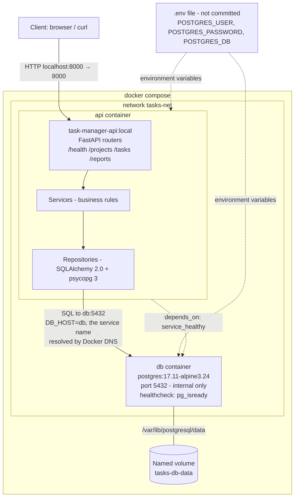
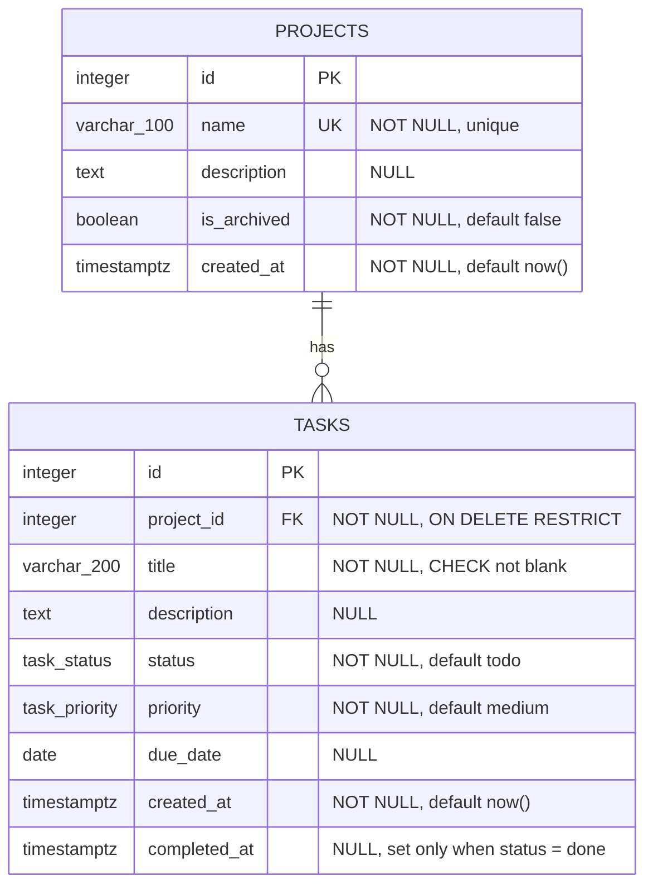

# task-manager-ci

[](https://github.com/sebas1621/task-manager-ci/actions/workflows/ci.yml)

A small task manager REST API (FastAPI + SQLAlchemy + Alembic) backed by PostgreSQL 17,
packaged as two Docker containers orchestrated with Docker Compose. The app is a vehicle to
demonstrate Docker, container communication and continuous integration.

## Repository structure

```
.
├── api/                  # Service 1: FastAPI app, tests, Alembic migrations, Dockerfile
├── docker-compose.yml    # api + db services, network tasks-net, volume tasks-db-data
├── .env.example          # Fake environment values; copy to .env
└── README.md
```

Service 2 (`db`) uses the official `postgres:17.11-alpine3.24` image and has no code in the repo.

## Architecture

Two containers on a user-defined bridge network. The API reaches PostgreSQL through the
Compose **service name** `db`, resolved by Docker's internal DNS (never localhost or a fixed IP).
Only the API port is published to the host.



## Data model

`status` is one of `todo`, `in_progress`, `done`; `priority` is one of `low`, `medium`, `high`.
A database check keeps `completed_at` set only while the task is `done`.



## Prerequisites

- Docker with Docker Compose v2 (`docker compose version`)

## Run with Docker Compose

```bash
cp .env.example .env                 # then edit the values if you wish; never commit .env
docker compose up -d --build --wait  # build the API image, start both containers, wait until healthy
docker compose ps                    # both services should be "healthy"
curl http://localhost:8000/health    # {"status":"ok","database":"ok"}
```

`docker compose up --build` (without `-d`) also works and runs in the foreground with live logs.
If you changed `API_PORT` in `.env`, replace `8000` in the URLs with that port.
Interactive API docs: http://localhost:8000/docs

The API reaches PostgreSQL through the service name `db` on the custom network `tasks-net`
(`DB_HOST=db`), never through localhost or an IP. Migrations run automatically at API startup.
The database port is not published to the host. Data lives in the named volume `tasks-db-data`.

### Round trip example

Use the `id` returned by `POST /projects` as `project_id` (it is `1` on a fresh database;
run `docker compose down -v` first for a clean start).

```bash
curl -X POST http://localhost:8000/projects \
  -H "Content-Type: application/json" -d '{"name": "Demo"}'

curl -X POST http://localhost:8000/tasks \
  -H "Content-Type: application/json" -d '{"project_id": 1, "title": "First task"}'

curl http://localhost:8000/tasks
```

### Logs and shutdown

```bash
docker compose logs api     # API logs (includes the Alembic migration output)
docker compose down         # stop and remove containers; keep the database volume
docker compose down -v      # also delete the database volume (data is lost)
```

## Continuous integration

GitHub Actions (`.github/workflows/ci.yml`) runs on every push and pull request:

1. `lint-test`: `ruff check`, `ruff format --check` and `pytest` with coverage (pip cache enabled).
2. `docker` (after `lint-test`): builds the `task-manager-api` image with Buildx and the GitHub
   Actions layer cache, runs `docker compose up -d --no-build --wait` with a `.env` made from `.env.example`,
   then a smoke test: `/health`, create a project, create a task, list tasks and read the summary.
   The stack is always removed with `docker compose down -v`.

## Local development (tests and lint)

From `api/`:

```bash
pip install -r requirements-dev.txt
ruff check .
ruff format --check .
pytest
```
